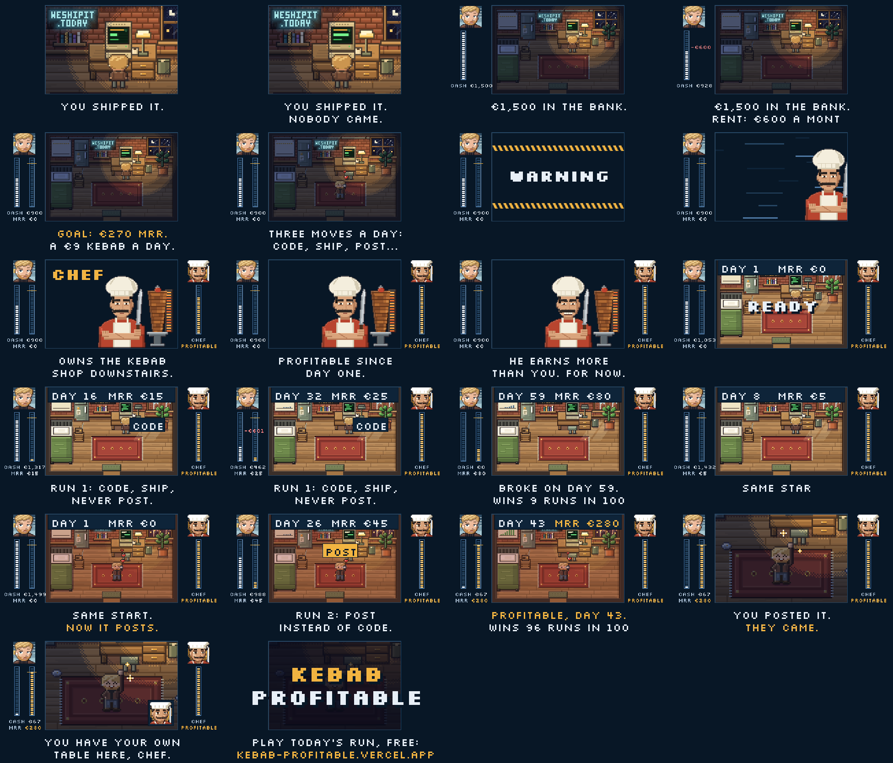

# The launch film

A 48-second film for the Product Hunt launch: the same run, played twice by
the same player. It goes broke on day 59 when it never posts, and it is kebab
profitable on day 43 when it posts instead of coding. Chef, downstairs, has
been profitable since day one.



## Make it

```bash
cd video
npm install                # esbuild and playwright-core; uses the Chrome installed on this machine
npm run render             # everything, about 2 minutes
node scripts/render.mjs stills   # stills and contact sheets only, a few seconds
```

It writes to `out/`:

| File | What |
| --- | --- |
| `master_16x9.mp4` | 1920×1080, 60 fps, H.264 (crf 16, yuv420p), AAC |
| `cut_9x16.mp4` | 1080×1920, the same film recomposed |
| `cut_1x1.mp4` | 1080×1080, the same film recomposed |
| `master_16x9_reduced_motion.mp4` | the same scenes and words with no movement |
| `captions.srt` | the on-screen lines and the sound cues |
| `contact.png` | a still at every beat of the master |
| `stills/` | the same stills for each format, and their contact sheets |

## How it is built

- `src/timeline.ts` holds every beat, line, cue and number. Change the film there.
- `src/film.ts` paints a frame: `paint(ctx, format, t, reduced)` is a pure function of time. The room and the founder are drawn by the game's own `src/ui/pixels.ts`, and Chef comes from the intro's sprite sheet.
- `src/audio.ts` renders the soundtrack offline from the same timeline: an original bed plus the game's own effects.
- `src/font.ts` turns Silkscreen into hard pixels, so the text sits on the art's grid.
- `scripts/render.mjs` bundles, serves, steps headless Chrome through t = n/60 and pipes the frames to ffmpeg.
- `scripts/runs.ts` and `scripts/claims.ts` produce every number from the rules engine (see `SOURCES.md`).
- `DECISIONS.md` logs the creative calls, and `directions.html` the four directions that were considered.

## What was tested

These checks were run, and the results are the ones seen on the last render:

- **Determinism.** One frame (t = 37.517 s) was rendered in two separate pages after different earlier frames, and the pixels are identical. `render.mjs` runs this check every time.
- **Fit.** Every line fits its band in every format, with at most two lines and eight words. `render.mjs` refuses to render otherwise.
- **Loudness.** The master measures -16.0 LUFS integrated with a true peak of -1.5 dBFS (ffmpeg `ebur128`).
- **Output.** All four files are 48.0 s, 60 fps, yuv420p, at the sizes listed above (ffprobe).
- **Phone width.** Frames of the 16:9 and 9:16 cuts were scaled to 390 px wide and every caption line was read. The small cash and MRR figures under the bars are not legible at that width. The MRR that tells the story is repeated large beside the day counter.
- **Contrast** against the ground: body text 15.6:1, accent 9.8:1, secondary 11.0:1, red 7.7:1.
- **Blinking.** READY and WARNING blink 2.5 times a second, under the limit of three. Nothing else flashes.
- **Muted.** The story was read from the contact sheets alone, with no sound.
- **Design review.** A separate reviewer was asked: who is it for, what does it communicate, what needs a name, and what to cut. It found these, which were fixed:
  - the cash readout disagreed with "€1,500 in the bank";
  - "9% win" did not say what it measured;
  - "same run" and "run 2" named one thing two ways;
  - the runs looked alike on a phone;
  - Chef had no payoff;
  - "CHEF" was clipped in the 1:1 cut.

## What was not tested

- Nobody has listened to the soundtrack. Its shape was checked on a waveform and spectrogram, and its loudness measured, but not by ear.
- No before/after frame pairs were kept for the review fixes. The old stills were overwritten by the new render.
- It has not been watched on a phone, and it has not been played inside Product Hunt.
- No accessibility review beyond contrast, blink rate, captions and the reduced-motion cut.

## For Product Hunt

The gallery takes a video as a YouTube or Loom link. Upload `master_16x9.mp4`
there, then set the link as the launch's video. Use the 9:16 and 1:1 cuts on X,
LinkedIn and Instagram.
